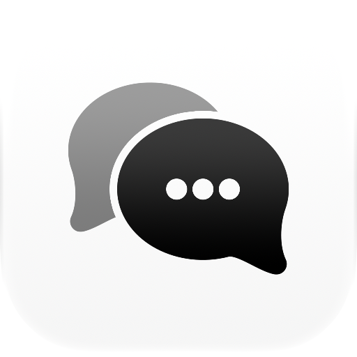

<br/>
<p align="center">
  <picture>
    <source media="(prefers-color-scheme: dark)" srcset="logo/icon-dark.png">
    
  </picture>
</p>

<h1 align="center">Working</h1>

<p align="center">Google Chat as a real Mac app.</p>

---

Google Chat lives in a browser tab or a wrapped web page: slow to open, easy to lose, and blind to the rest of your Mac. Working is a native client written in Rust. It opens from a local cache before the network answers, keeps up through Google's realtime stream, and behaves like a Mac app: Dock badge, system notifications, keyboard first, light and dark.

Working is an independent project. It is not affiliated with or endorsed by Google.

## Features

- **Every conversation in one place.** DMs, group DMs, spaces, and apps in a sidebar, with Mentions and Starred views that gather messages from every chat.
- **Fast to open, fast to switch.** A disk cache paints the last state on launch. `Cmd+K` jumps to any conversation with fuzzy search, and Enter in the search bar searches message text.
- **Pick a layout.** Google Chat's sidebar, a Messages-style list with previews, or a Rail of categories beside the list, each sortable by most recent or A to Z. The sidebar button opens or closes the sidebar, and a right-click auto-hides it: closed until the pointer reaches the window's edge. The sidebar can sit on either side and resizes by its edge. `Option+Cmd+Down` and `Option+Cmd+Up` step through conversations, `Shift+Option+Cmd+Down` jumps to the newest unread one\.
- **Full conversations.** Formatted text, threads, replies, quotes, edits, reactions with a full emoji picker, cards, and attachments.
- **Media viewer.** Images open in a zoomable viewer; video, audio, PDF, and text files open inside the app.
- **Google Meet in its own window.** Join calls with camera, microphone, and screen sharing, in a window that looks like the rest of the app.
- **Notifications that respect your time.** System notifications with a choice of sounds, an unread count on the Dock icon, and the do-not-disturb schedules your Google account already keeps.
- **Presence on your terms.** Show as active automatically, only during working hours, or always online or away, and set a custom status.
- **Rewrite a draft.** `Cmd+Shift+R` rewrites the message you are writing through the Claude Code or Codex CLI you already have installed, with its tools turned off.
- **28 color themes.** Pick one for light mode and one for dark mode, and Working follows the system.
- **Local MCP server.** Optional. Lets AI agents on your Mac read and search your chats, and send as you if you allow it. It listens on localhost only and requires a token.
- **Updates itself.** New versions install in the background. A **Restart** card appears when one is ready.

## Install

```bash
brew install --cask felipefdl/tap/working
```

Or download the `.dmg` from [Releases](https://github.com/felipefdl/working/releases). Working runs on macOS 13 or newer, on Apple silicon and Intel.

Open the app and sign in with Google on the welcome screen. Settings, the session, and the MCP token live in `~/.config/working`; the cache lives in `~/Library/Caches/working`.

## MCP server

Turn it on in Settings. It listens on `http://127.0.0.1:3021/mcp` and needs the token in `~/.config/working/mcp-token`. Agents can list and search conversations and read messages. Sending is a separate switch.

## Build from source

You need Rust 1.99.1 or newer, [just](https://github.com/casey/just), and Xcode (its `actool` compiles the app icon).

```bash
git clone https://github.com/felipefdl/working.git
cd working
just run
```

| Command | What it does |
|---|---|
| `just run` | Build `Working.app` and open it |
| `just run-readonly` | Same app, but it refuses anything that writes to the Google account |
| `just demo` | Same app with a made-up workspace instead of a Google account: no sign-in, nothing leaves the Mac |
| `just check` | Quality gate: format, lints, supply chain, tests |
| `just probe` | Read-only protocol smoke test that prints counts and event types, never message text |
| `just logo` | Rebuild the logo and icon images |

With an Apple Development certificate in your keychain, local builds keep camera and microphone permissions across rebuilds. Without one, macOS asks again after every build.

The app is `crates/app` (GPUI). The Google Chat protocol, realtime stream, cache, and MCP server are in `crates/core`, and the app talks to them only through commands and events.

## Contributing

Issues and pull requests are welcome. See [CONTRIBUTING.md](CONTRIBUTING.md) and the [Code of Conduct](CODE_OF_CONDUCT.md).

## License

[MIT](LICENSE.md)
