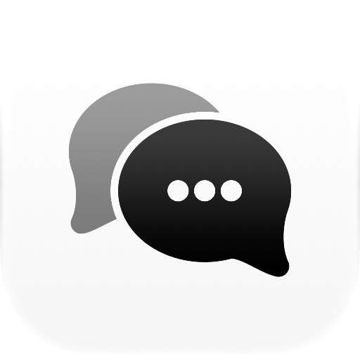
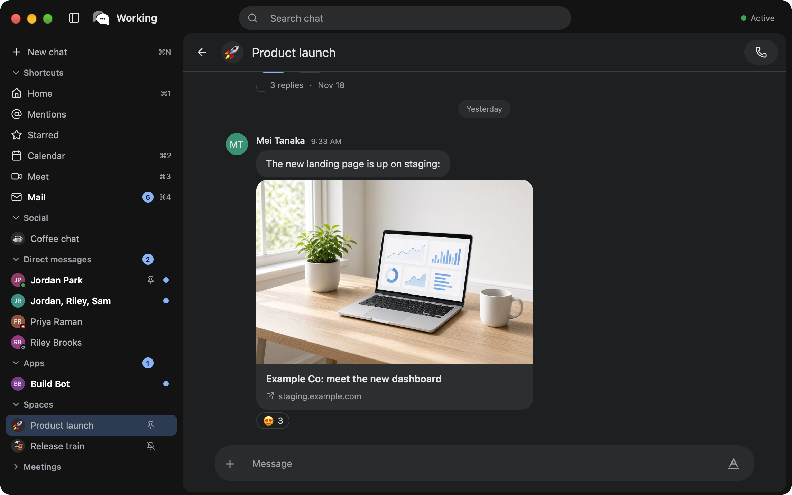
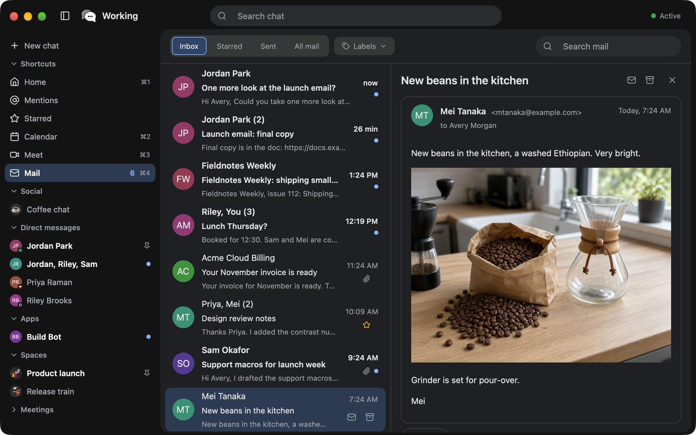
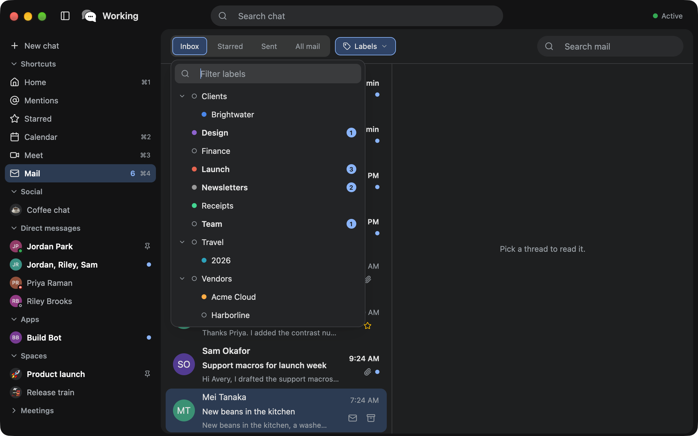
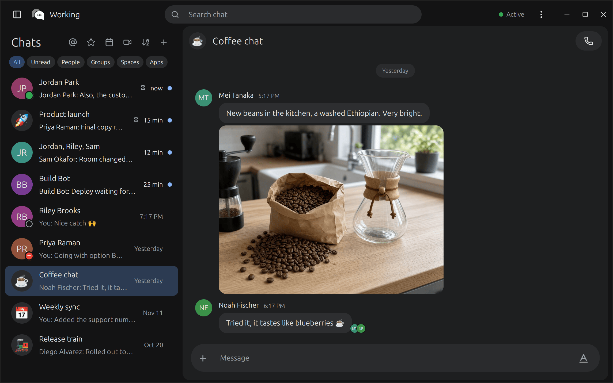

<br/>
<p align="center">
  <picture>
    <source media="(prefers-color-scheme: dark)" srcset="logo/icon-dark.png">
    
  </picture>
</p>

<h1 align="center">Working</h1>

<p align="center">Google Chat, Gmail, Calendar, and Meet in one desktop app for macOS, Linux, and Windows.</p>

<p align="center">
  
</p>

---

Google Chat, Gmail, and Calendar live in browser tabs or wrapped web pages: slow to open, easy to lose, and blind to the rest of your desktop. Working is a native app written in Rust that puts them and Meet in one window, for the Google account you sign in with. It opens from a local cache before the network answers, keeps chats up through Google's realtime stream, and behaves like an app of your system: an unread badge, system notifications, keyboard first, light and dark.

Working is an independent project. It is not affiliated with or endorsed by Google.

## A look around

Pick the layout that fits how you work, switch any time in Settings, and keep Calendar, Meet, and Mail a key away.

<table>
  <tr>
    <td width="50%"><br><b>Messages.</b> Every chat in one list with previews, beside the conversation. Or keep the Google Chat sidebar you already know.</td>
    <td width="50%"><br><b>Rail.</b> People, Groups, Spaces, and Apps one click away, with unread counts on each.</td>
  </tr>
  <tr>
    <td width="50%"><br><b>Calendar.</b> Google Calendar in the same window: day to year views, event cards with Join and going or not, and an editor for new events.</td>
    <td width="50%"><br><b>Meet.</b> The day's meetings, a field to join with a code or a link, and new meetings in a click.</td>
  </tr>
  <tr>
    <td width="50%"><br><b>Mail.</b> Gmail in the same window: the thread list beside the open email, rendered as it was sent.</td>
    <td width="50%"><br><b>Labels.</b> Your own Gmail labels as a tree with their colors and unread counts, filtered as you type.</td>
  </tr>
  <tr>
    <td width="50%"><br><b>Find people fast.</b> Filter to just people, groups, spaces, apps, or unread, then sort by recent or A to Z.</td>
    <td width="50%"><br><b>28 themes.</b> Ayu, Catppuccin, Dracula, Tokyo Night, and more, previewed live with ⌘⇧T.</td>
  </tr>
  <tr>
    <td width="50%"><br><b>Make it yours.</b> Layout, message style, sidebar side and width, auto-hide: all a click away.</td>
    <td width="50%"><br><b>Try it without an account.</b> These screenshots come from demo mode's made-up workspace. Run <code>just demo</code> to explore every feature before you sign in.</td>
  </tr>
  <tr>
    <td width="50%"><br><b>On Windows.</b> The same app, with the window buttons where Windows puts them.</td>
    <td width="50%"><br><b>On Linux.</b> An AppImage for x86_64 and Arm64, with color emoji on every distribution.</td>
  </tr>
</table>

## Features

- **Every conversation in one place.** DMs, groups, spaces, and apps, with Mentions and Starred views across all of them.
- **Four layouts.** Google Chat's sidebar, a Messages-style list with previews, a Rail of categories, or an IRC-style list of names with an aligned, monospaced message style to match.
- **Fast.** A disk cache paints the last state on launch, and `Cmd+K` jumps to any conversation.
- **Full conversations.** Formatted text, threads, quotes, edits, reactions, cards, attachments, and read receipts.
- **Format as you write.** Bold, italic, strikethrough, lists, and code, from a bar or from the keyboard.
- **Gmail in the same window.** `Cmd+4` opens Mail: mailboxes, labels, Gmail search, new emails, replies, and archive. See [Mail](#mail).
- **Calendar and Meet in the same window.** `Cmd+2` opens Google Calendar, `Cmd+3` opens Google Meet. The event editor makes new events and changes existing ones.
- **Calls in their own window.** Camera, microphone, screen sharing, and the call's chat. On Linux, meetings open in your browser.
- **Media viewer.** Images, video, audio, PDF, and text files open inside the app, files kept in Google Drive included.
- **Notifications and presence.** System notifications for messages, new mail, and event reminders, an unread badge, do-not-disturb schedules, and a custom status.
- **Rewrite a draft.** `Cmd+Shift+R` rewrites your message through the Claude Code or Codex CLI you already have.
- **28 themes and your own fonts.** One theme for light, one for dark.
- **MCP server.** Optional and local, with a switch for each group of tools: see [MCP server](#mcp-server).
- **Updates itself.**

Shortcuts are written the macOS way; on Linux and Windows, Ctrl takes the place of Cmd.

## Mail

Mail is Gmail, through the session you signed in with: there is no second sign-in, and no Gmail API key or OAuth app to set up.

- **Mailboxes and labels.** Inbox, Starred, Sent, and All mail. The Labels control beside them, or `Cmd+L`, opens your own labels as a tree with their colors and unread counts, under a field that filters them by name.
- **Search.** The search field takes the same queries as Gmail's search box.
- **Reading.** The reading pane sits beside the list when the window is wide enough, and in its place when it is not. Each email renders its HTML in the system web view, in the theme's colors where it sets none; its scripts, frames, and forms never run, and links open in your browser. A switch on an email shows every HTML email on the other background (light under a dark theme, dark under a light one), and Working remembers it. Attachments open in the media viewer.
- **Writing.** `c` or the New email button opens a form with To and Cc as chips, suggested from the people directory, a subject, and a body. Reply and Reply all open a box under the last email. `Cmd+Enter` sends. New emails and replies carry the signature set in Gmail, shown under the body with a button to leave it out, and `Cmd+Shift+R` rewrites the body as it does a chat message.
- **Changes.** Archive from the Inbox with an Undo bar, and Mark as unread. A thread you open is marked read.
- **New mail.** The inbox's first page shows from disk before Gmail answers. Working checks the inbox every minute, posts a notification for each unread email that arrives, and adds unread inbox threads to the unread badge.

The Mail view does not forward, star, label, or delete; an agent you allow can forward, star, and label through the [mail tools](#mcp-server). `just run-readonly` refuses every change. What differs on each system is in [docs/platforms.md](docs/platforms.md#mail).

## Features

Settings opens on Features, with one switch each for Calendar, Meet, and Mail. A feature that is off is gone everywhere: its view, its buttons and number key, its notifications (for Mail also its count in the Dock), and its MCP tools, whatever their own switch says. While Mail is off, Working does not read Gmail. While Meet is off, meeting links open in the browser. Under Layout, View buttons shows or hides the Mentions and Starred buttons.

## Install

Download a build from the [Releases](https://github.com/felipefdl/working/releases) page, then sign in with Google on the welcome screen.

| System | Install |
|---|---|
| macOS 13 or newer | `brew install --cask felipefdl/tap/working`, or the `.dmg` |
| Linux | The `.AppImage` for your architecture: `chmod +x`, then run it |
| Windows | The `-setup.exe` for your architecture |

- **Linux** needs GTK 3, WebKitGTK 4.1, libsoup 3, and an X11 or XWayland session.
- **Windows:** the installer is not code-signed, so SmartScreen warns: choose **More info**, then **Run anyway**.

Requirements, known limits, shortcuts, and file locations for each system are in [docs/platforms.md](docs/platforms.md).

## MCP server

Working serves one MCP server, named `working`, by default at `http://127.0.0.1:3021/mcp`, for this computer only. In Settings, under Agents, the Address row's Change button sets its address and port; another address, such as `0.0.0.0`, shares it with your network, and the token and the refusal of requests from web pages still apply. Agents also has a switch for each group of tools, and each is off until you turn it on; the server lists and runs only the tools of the groups that are on, and with every group off it does not listen. The Calendar, Meet, and Mail tools also need their feature on in [Features](#features). The server takes the token in the `mcp-token` file beside the settings, as a bearer header or as one more path segment (`/mcp/<token>`). Settings copies its link and token, and **Add to an agent** copies the setup for Claude Code, Codex, Grok, Pi, omp, Hermes, OpenClaw, or Antigravity, for every project.

| Tool group | Tools |
|---|---|
| Chat | `inbox`, `recent_activity`, `find_conversations`, `read_conversation`, `search_messages`; `send_message` only with **Let agents send messages** |
| Mail | `mail_inbox`, `mail_search`, `mail_read_thread`, `mail_html`, `mail_eml`, `mail_labels`, `mail_attachment`; with **Let agents send and change mail**, also `mail_send`, `mail_reply`, `mail_forward`, `mail_draft`, `mail_send_draft`, `mail_archive`, `mail_mark`, `mail_star`, `mail_label` |
| Calendar | `calendar_list`, `calendar_events`, `calendar_get_event`; with **Let agents change events**, also `calendar_create_event`, `calendar_update_event`, `calendar_delete_event`, `calendar_respond` |
| Meet | `meet_create_meeting`, `meet_upcoming` |

What an agent sends is real: a chat message or an email reaches its recipients at once, as you. `mail_send` takes `to`, `cc`, and `bcc`. `mail_reply` answers the thread's newest email from someone else, or the one its `message` names (an id `mail_read_thread` shows), and addresses it the way Gmail's Reply and Reply all do; the agent does not pick the recipients. `mail_forward` sends an email on as a new email on a thread of its own, with `Fwd:` before the subject and the email quoted under what the agent writes; the email's attached files are not sent with it, and pictures inside it that need your Gmail session do not show for the recipient. `mail_draft` saves a new email or a reply in your Gmail Drafts without sending it, for you to look over; `mail_send_draft` sends it exactly as saved, until Working restarts, and after that you send it from Gmail's Drafts. `mail_star` and `mail_label` star threads and put on or take off your own labels; making a label is left to Gmail. `mail_attachment` saves an email's file in Working's own folder, which Working empties when it starts, and refuses files over 25 MB. Reading leaves chats and mail unread. Under `just run-readonly` every tool that sends or changes something refuses.

`mail_read_thread` gives emails as plain text. `mail_html` saves them as HTML pages in the same folder `mail_attachment` uses, one page an email, as the email looks in Gmail under who wrote it, to whom, and when, so an agent can open one in a browser or print it to a PDF. The pictures inside an email that need your Gmail session are embedded in its page, up to 25 MB an email; pictures from the web stay as addresses. `mail_eml` saves them there as `.eml` files, each the email exactly as it was sent, with every header, part, and attached file, for archiving it or opening it in another mail program; it refuses one over 25 MB, and a draft has none.

## Build from source

You need Rust 1.100.0 or newer, `protoc`, and [just](https://github.com/casey/just). Each system's packages are listed under [build prerequisites](docs/platforms.md#build-prerequisites).

```bash
git clone https://github.com/felipefdl/working.git
cd working
just run
```

| Command | What it does |
|---|---|
| `just run` | Build optimized and run |
| `just demo` | Run with a made-up workspace: no sign-in, nothing leaves the computer |
| `just run-readonly` | Run without writing anything to the Google account |
| `just check` | Quality gate: format, lints, supply chain, tests |

The app is `crates/app` (GPUI). The Google Chat protocol and realtime stream, the Gmail and Google Calendar clients, the cache, and the MCP server are in `crates/core`.

## Contributing

Issues and pull requests are welcome. See [CONTRIBUTING.md](CONTRIBUTING.md) and the [Code of Conduct](CODE_OF_CONDUCT.md).

## License

[MIT](LICENSE.md)
