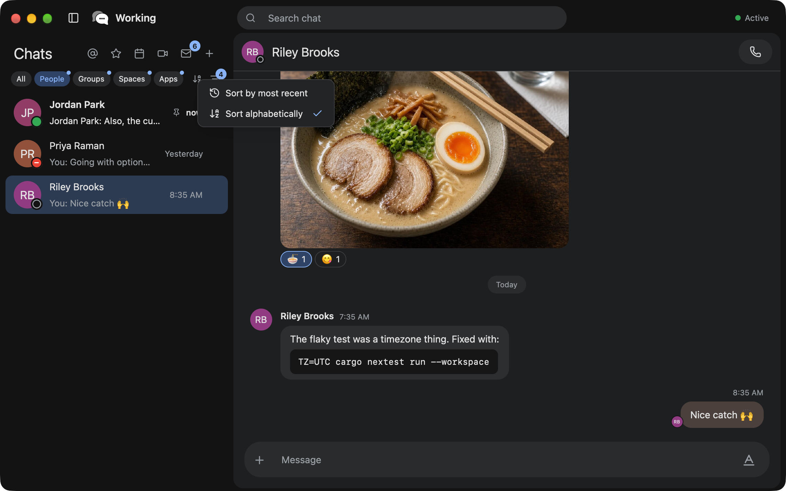
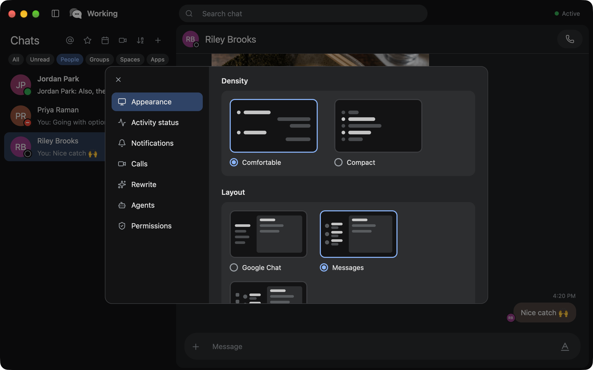

<br/>
<p align="center">
  <picture>
    <source media="(prefers-color-scheme: dark)" srcset="logo/icon-dark.png">
    
  </picture>
</p>

<h1 align="center">Working</h1>

<p align="center">Google Chat as a real desktop app for macOS, Linux, and Windows.</p>

<p align="center">
  
</p>

---

Google Chat lives in a browser tab or a wrapped web page: slow to open, easy to lose, and blind to the rest of your desktop. Working is a native client written in Rust. It opens from a local cache before the network answers, keeps up through Google's realtime stream, and behaves like an app of your system: an unread badge, system notifications, keyboard first, light and dark.

Working is an independent project. It is not affiliated with or endorsed by Google.

## Your chats, your way

Pick the layout that fits how you work, switch any time in Settings, and every list sorts and filters the way you think about people.

<table>
  <tr>
    <td width="50%"><br><b>Google Chat.</b> The sidebar you already know, with sections, Mentions, and Starred, just faster.</td>
    <td width="50%"><br><b>Rail.</b> People, Groups, Spaces, and Apps one click away, with unread counts on each.</td>
  </tr>
  <tr>
    <td width="50%"><br><b>Find people fast.</b> Filter to just people, groups, spaces, apps, or unread, then sort by recent or A to Z.</td>
    <td width="50%"><br><b>28 themes.</b> Ayu, Catppuccin, Dracula, Tokyo Night, and more, previewed live with ⌘⇧T.</td>
  </tr>
  <tr>
    <td width="50%"><br><b>Make it yours.</b> Layout, density, sidebar side and width, auto-hide: all a click away.</td>
    <td width="50%"><br><b>Try it without an account.</b> These screenshots come from demo mode's made-up workspace. Run <code>just demo</code> to explore every feature before you sign in.</td>
  </tr>
</table>

## Features

Shortcuts are written the macOS way. On Linux and Windows, Ctrl takes the place of Cmd, except that Alt+Up and Alt+Down step through conversations, Shift+Alt+Down jumps to the newest unread one, and Ctrl+Shift+S opens or closes the sidebar. Settings and the app's menus show each shortcut the way your system writes it.

- **Every conversation in one place.** DMs, group DMs, spaces, and apps in a sidebar, with Mentions and Starred views that gather messages from every chat. Settings can hide the Mentions, Starred, Calendar, and Meet buttons in any layout; the views still open from their keys and the Go menu.
- **Your calendar beside your chats.** `Cmd+2` opens Google Calendar in the same window: Day, 4 days, Week, Month, Year, and Schedule views, a quick event card with Join Meet, going or not, and an editor for new events, guests, repeats, and colors. Its button sits in the sidebar, the Chats header, or the Rail, depending on the layout, and a switch in Settings hides it (`Cmd+2` and the Go menu still work).
- **Meet beside your chats.** `Cmd+3` opens Google Meet in the same window: join with a code, a link, or a nickname, start or plan a meeting from New, see the day's meetings that have a Meet link, and call someone from your contacts. Its button sits in the sidebar, the Chats header, or the Rail, depending on the layout, and a switch in Settings hides it (`Cmd+3` and the Go menu still work).
- **Fast to open, fast to switch.** A disk cache paints the last state on launch. `Cmd+K` jumps to any conversation with fuzzy search, and Enter in the search bar searches message text.
- **Pick a layout.** Google Chat's sidebar, a Messages-style list with previews, or a Rail of categories beside the list, each sortable by most recent or A to Z. The sidebar button opens or closes the sidebar, and a right-click auto-hides it: closed until the pointer reaches the window's edge. The sidebar can sit on either side and resizes by its edge. `Option+Cmd+Down` and `Option+Cmd+Up` step through conversations, `Shift+Option+Cmd+Down` jumps to the newest unread one\.
- **Full conversations.** Formatted text, threads, replies, quotes, edits, reactions with a full emoji picker, cards, and attachments.
- **Read receipts.** Where Google Chat has them on, the small round avatar of each person who has read a conversation sits beside the last message they read, and moves as they read on. People on the same message overlap (four at most, then a count), hovering names them, and threads show them too.
- **Format as you write.** Bold, italic, strikethrough, bulleted lists, code, and code blocks, from a bar above the text (the underlined A at the composer's right shows or hides it) or from `Cmd+B`, `Cmd+I`, `Shift+Cmd+X`, and `Shift+Cmd+8`, which work with the bar hidden too. The draft keeps Google Chat's own markers (`*bold*`, `_italic_`, `~strike~`), so typing them by hand formats the same way.
- **Media viewer.** Images open in a zoomable viewer; video, audio, PDF, and text files open inside the app.
- **Google Meet in its own window.** Join calls with camera, microphone, and screen sharing, in a window that looks like the rest of the app. On Linux, meetings open in your default browser instead (see [Linux](#linux)).
- **Notifications that respect your time.** System notifications, an unread count on the app icon where the system shows one (the Dock on macOS; KDE Plasma, Ubuntu Dock, and Dash to Dock on Linux), and the do-not-disturb schedules your Google account already keeps. On macOS, pick from the system's notification sounds.
- **Presence on your terms.** Show as active automatically, only during working hours, or always online or away, and set a custom status.
- **Rewrite a draft.** `Cmd+Shift+R` rewrites the message you are writing through the Claude Code or Codex CLI you already have installed, with its tools turned off.
- **28 color themes.** Pick one for light mode and one for dark mode, and Working follows the system.
- **Your fonts.** Settings picks the interface font and the monospace font for code from the families installed on your computer; System keeps the system's own fonts. Both apply at once.
- **Local MCP server.** Optional. Lets AI agents on your computer read and search your chats, and send as you if you allow it. It listens on localhost only and requires a token.
- **Updates itself.** New versions download in the background, and a **Restart** card appears when one is ready. On Linux, the AppImage updates itself; a copy installed any other way does not.

## Install

Every release on the [Releases](https://github.com/felipefdl/working/releases) page has a build for each system.

### macOS

```bash
brew install --cask felipefdl/tap/working
```

Or download `Working_<version>_universal.dmg`. Working runs on macOS 13 or newer, on Apple silicon and Intel.

### Linux

Download `Working_<version>_x86_64.AppImage` or `Working_<version>_aarch64.AppImage`, make it executable (`chmod +x`), and run it. It uses these system libraries rather than carrying its own:

- GTK 3, WebKitGTK 4.1, and libsoup 3 (on Debian and Ubuntu `libgtk-3-0`, `libwebkit2gtk-4.1-0`, `libsoup-3.0-0`; on Fedora `gtk3`, `webkit2gtk4.1`, `libsoup3`)
- An X11 session, or XWayland under Wayland
- A glibc at least as new as Ubuntu 24.04's, where the release is built

The first time the AppImage runs, a card in the window asks to add Working to your apps menu. **Add** writes `~/.local/share/applications/working.desktop`, which runs the AppImage where it is, and the icon `~/.local/share/icons/hicolor/512x512/apps/working.png` (under `$XDG_DATA_HOME` when it is set); the dock and the launcher then show Working's icon and name, the open window included. Each start rewrites the entry when the AppImage has moved or been replaced. **No thanks** writes nothing, and the app does not ask again. **Settings › Appearance › Show in apps menu** changes the answer: off removes those two files, and only those, and the dock goes back to a generic icon and the name `working`. Working neither asks nor writes under the AppImage opt-outs (a running `appimaged`, a `no_desktopintegration` file in `$XDG_DATA_HOME/appimagekit`, `/usr/share/appimagekit`, or `/etc/appimagekit`, or a non-empty `DESKTOPINTEGRATION` variable), or when a desktop entry for the AppImage that it did not write is already there, such as one from AppImageLauncher or Gear Lever.

On Linux, Meet opens in your default browser: joining from a meeting card, the Meet view, a conversation's call button, or a `https://meet.google.com/...` link given to `working` on the command line all hand the link to the browser. WebKitGTK as Fedora builds it has no WebRTC (`RTCPeerConnection` is missing even with WebRTC turned on), and the webview refuses camera and microphone requests, so a call cannot run inside the app. The call button still posts the meeting in the chat.

On Linux, Working draws emoji with its own copy of Google's Noto Color Emoji on every distribution. GPUI's Linux text stack cannot draw the COLRv1 color emoji font some distributions install (Fedora's `Noto-COLRv1.ttf`), so emoji would otherwise be blank there ([zed#42255](https://github.com/zed-industries/zed/issues/42255), [swash#21](https://github.com/dfrg/swash/issues/21)). The system emoji font is not used and does not need replacing. In the composer, an emoji the interface font also has, such as `❤️`, shows as that font's black glyph; the sent message shows it in color.

In the media viewer, a video can stay black while its sound plays. This was seen in a Fedora 44 virtual machine whose GStreamer had the needed demuxers and decoders (Matroska, VP8, VP9, AV1, H.264), so missing codec packages are not the cause there. The cause is still open: the most likely one is that VM's VA-API video decoder, which isn't confirmed. Audio, PDF, and text files open normally.

On the welcome screen, after the sign-in page is canceled, the window can ignore clicks until it is resized or the pointer leaves it and comes back ([gpui-kit#3985](https://github.com/longbridge/gpui-kit/issues/3985)).

With the window maximized, a window button can keep its hover color after the pointer leaves the window through the top edge, until the pointer comes back in ([gpui-kit#3987](https://github.com/longbridge/gpui-kit/issues/3987)).

### Windows

Download `Working_<version>_x64-setup.exe` or `Working_<version>_arm64-setup.exe` and run it. It installs Working for your user only, with no administrator rights, and installs the Microsoft WebView2 runtime if it is missing. The installer is not code-signed, so SmartScreen warns before it runs: choose **More info**, then **Run anyway**.

### Where Working keeps its files

Open the app and sign in with Google on the welcome screen. Settings, the session, and the MCP token (`settings.json`, `cookies.json`, `mcp-token`) live in one folder, the cache in another:

| System | Settings and session | Cache |
|---|---|---|
| macOS | `~/.config/working` | `~/Library/Caches/working` |
| Linux | `$XDG_CONFIG_HOME/working` (`~/.config/working`) | `$XDG_CACHE_HOME/working` (`~/.cache/working`) |
| Windows | `%APPDATA%\working` | `%LOCALAPPDATA%\dev.felipefdl.working\cache` |

On Windows, the web views keep their data in `%LOCALAPPDATA%\dev.felipefdl.working\WebView2`.

## MCP server

Turn it on in Settings. It listens on `http://127.0.0.1:3021/mcp` and needs the token in the `mcp-token` file beside the settings. Agents can list and search conversations, read messages, and see which conversations wait on your reply, so "answer back with that" finds the right person. Sending is a separate switch, and an agent has to read a conversation before it sends there.

## Build from source

Every system needs Rust 1.99.1 or newer and `protoc` (the Protocol Buffers compiler).

- **macOS:** [just](https://github.com/casey/just), Xcode (its `actool` compiles the app icon), and `brew install protobuf`.
- **Linux:** [just](https://github.com/casey/just) and the development packages. On Debian and Ubuntu:

  ```bash
  sudo apt install libgtk-3-dev libwebkit2gtk-4.1-dev libsoup-3.0-dev libxkbcommon-x11-dev libx11-xcb-dev \
    libxcb1-dev libwayland-dev libfontconfig-dev libasound2-dev libvulkan-dev libdbus-1-dev protobuf-compiler \
    clang pkg-config
  ```

- **Windows:** the MSVC Rust toolchain with the Visual Studio Build Tools (C++ and the Windows SDK), `protoc` on the `PATH`, and on Arm64 clang on the `PATH` too. The recipes below are for macOS and Linux; on Windows, run the app with `cargo run --release -p working` (set `WORKING_DEMO=1` for the demo) and build the installer with `pwsh scripts/package-windows.ps1`, which needs `cargo install cargo-packager --version 0.11.8 --locked`. Notifications show only for the installed app, whose Start Menu shortcut carries the app's identity.

```bash
git clone https://github.com/felipefdl/working.git
cd working
just run
```

| Command | What it does |
|---|---|
| `just run` | Build optimized and run: `Working.app` on macOS, the binary on Linux |
| `just run-readonly` | Same app, but it refuses anything that writes to the Google account |
| `just demo` | Same app with a made-up workspace instead of a Google account: no sign-in, nothing leaves the computer |
| `just check` | Quality gate: format, lints, supply chain, tests |
| `just probe` | Read-only protocol smoke test that prints counts and event types, never message text |
| `just logo` | Rebuild the logo and icon images (macOS: needs resvg, Xcode, and ImageMagick) |

`./scripts/package-linux.sh` builds the AppImage into `target/dist`.

On macOS, with an Apple Development certificate in your keychain, local builds keep camera and microphone permissions across rebuilds. Without one, macOS asks again after every build. Notifications and the Dock badge need `Working.app` (`just run`), not a bare `cargo run`.

The app is `crates/app` (GPUI). The Google Chat protocol, realtime stream, cache, and MCP server are in `crates/core`, and the app talks to them only through commands and events.

## Contributing

Issues and pull requests are welcome. See [CONTRIBUTING.md](CONTRIBUTING.md) and the [Code of Conduct](CODE_OF_CONDUCT.md).

## License

[MIT](LICENSE.md)
