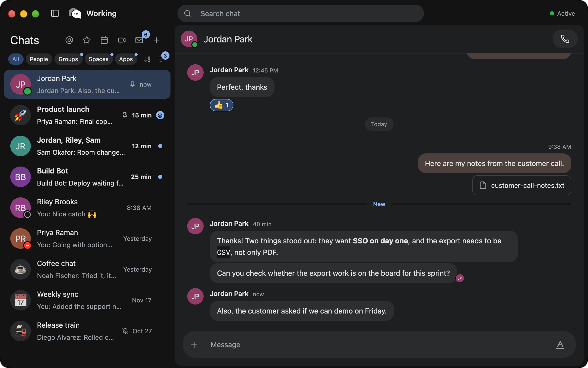
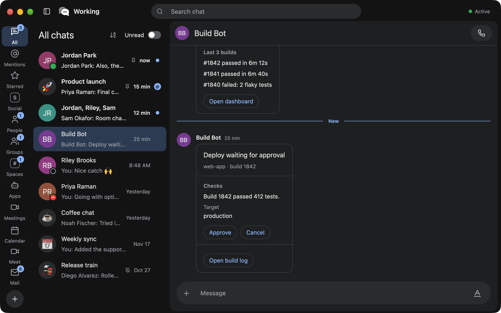
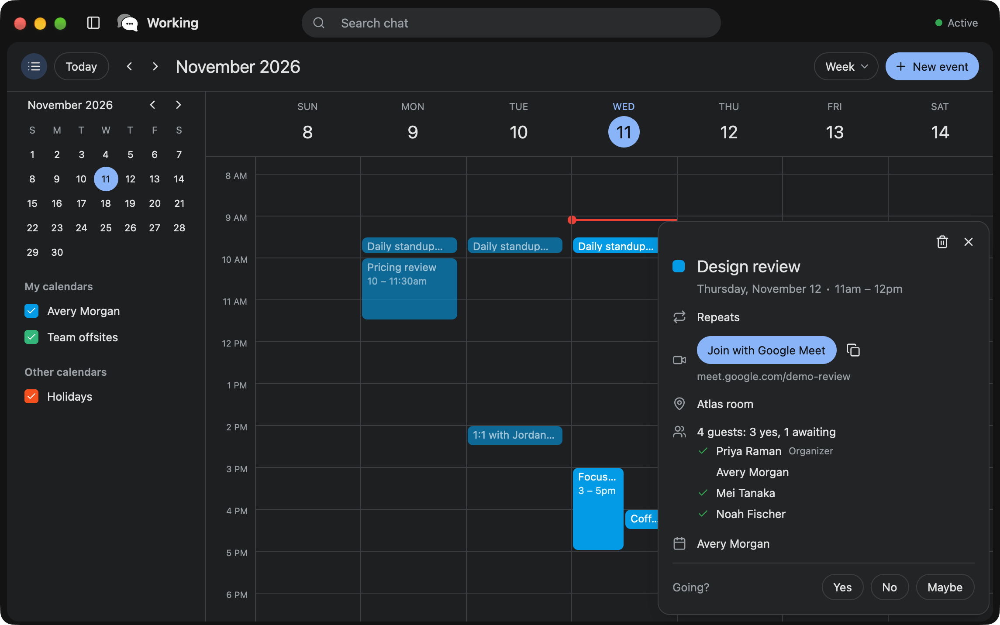
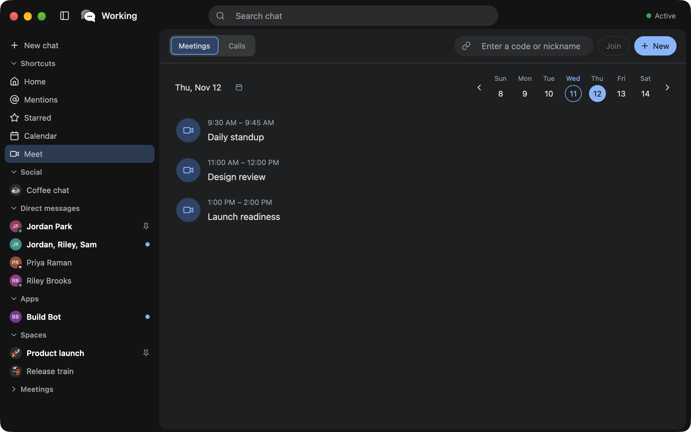
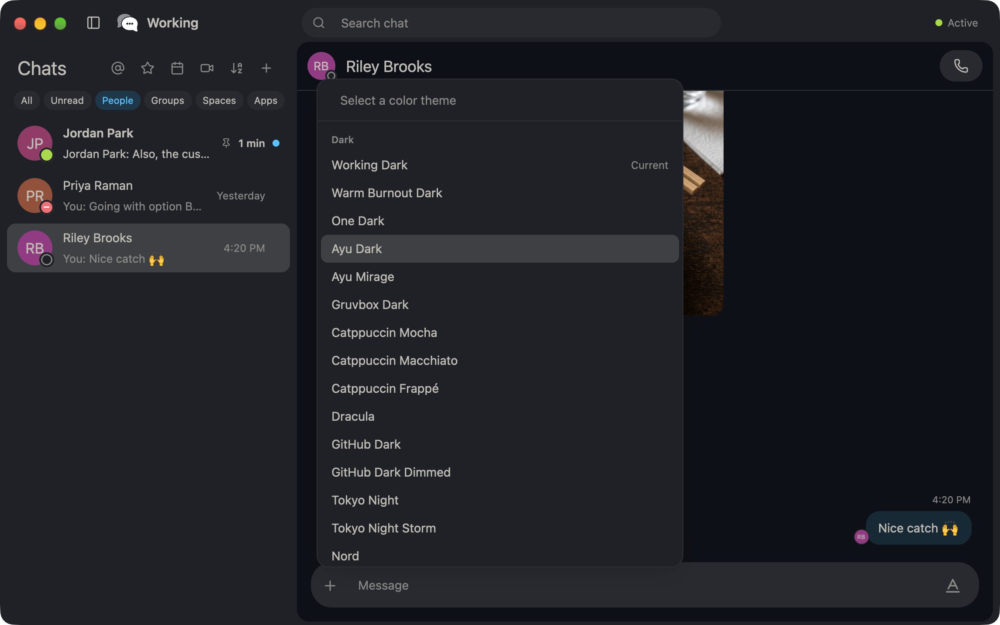
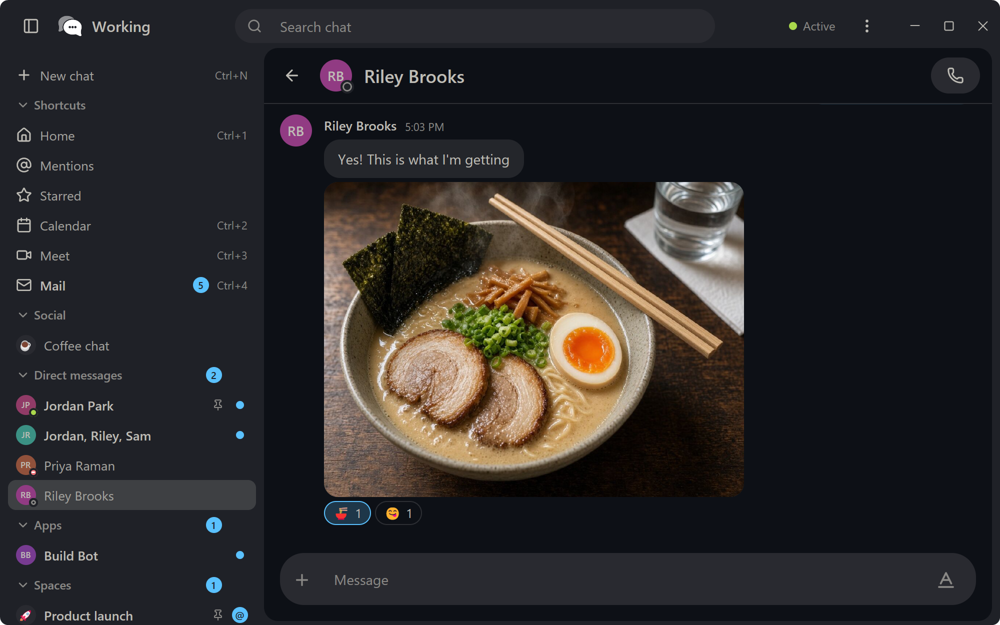

<br/>
<p align="center">
  <picture>
    <source media="(prefers-color-scheme: dark)" srcset="logo/icon-dark.png">
    
  </picture>
</p>

<h1 align="center">Working</h1>

<p align="center">Google Chat as a real desktop app for macOS, Linux, and Windows.</p>

<p align="center">
  
</p>

---

Google Chat lives in a browser tab or a wrapped web page: slow to open, easy to lose, and blind to the rest of your desktop. Working is a native client written in Rust. It opens from a local cache before the network answers, keeps up through Google's realtime stream, and behaves like an app of your system: an unread badge, system notifications, keyboard first, light and dark.

Working is an independent project. It is not affiliated with or endorsed by Google.

## Your chats, your way

Pick the layout that fits how you work, switch any time in Settings, and every list sorts and filters the way you think about people.

<table>
  <tr>
    <td width="50%"><br><b>Messages.</b> Every chat in one list with previews, beside the conversation. Or keep the Google Chat sidebar you already know.</td>
    <td width="50%"><br><b>Rail.</b> People, Groups, Spaces, and Apps one click away, with unread counts on each.</td>
  </tr>
  <tr>
    <td width="50%"><br><b>Calendar.</b> Google Calendar in the same window: day to year views, event cards with Join and going or not, and an editor for new events.</td>
    <td width="50%"><br><b>Meet.</b> The day's meetings, a field to join with a code or a link, and new meetings in a click.</td>
  </tr>
  <tr>
    <td width="50%"><br><b>Find people fast.</b> Filter to just people, groups, spaces, apps, or unread, then sort by recent or A to Z.</td>
    <td width="50%"><br><b>28 themes.</b> Ayu, Catppuccin, Dracula, Tokyo Night, and more, previewed live with ⌘⇧T.</td>
  </tr>
  <tr>
    <td width="50%"><br><b>Make it yours.</b> Layout, message style, sidebar side and width, auto-hide: all a click away.</td>
    <td width="50%"><br><b>Try it without an account.</b> These screenshots come from demo mode's made-up workspace. Run <code>just demo</code> to explore every feature before you sign in.</td>
  </tr>
  <tr>
    <td width="50%"><br><b>On Windows.</b> The same app, with the window buttons where Windows puts them.</td>
    <td width="50%"><br><b>On Linux.</b> An AppImage for x86_64 and Arm64, with color emoji on every distribution.</td>
  </tr>
</table>

## Features

- **Every conversation in one place.** DMs, groups, spaces, and apps, with Mentions and Starred views across all of them.
- **Four layouts.** Google Chat's sidebar, a Messages-style list with previews, a Rail of categories, or an IRC-style list of names with an aligned, monospaced message style to match.
- **Fast.** A disk cache paints the last state on launch, and `Cmd+K` jumps to any conversation.
- **Full conversations.** Formatted text, threads, quotes, edits, reactions, cards, attachments, and read receipts.
- **Format as you write.** Bold, italic, strikethrough, lists, and code, from a bar or from the keyboard.
- **Calendar and Meet in the same window.** `Cmd+2` opens Google Calendar, `Cmd+3` opens Google Meet.
- **Calls in their own window.** Camera, microphone, screen sharing, and the call's chat. On Linux, meetings open in your browser.
- **Media viewer.** Images, video, audio, PDF, and text files open inside the app.
- **Notifications and presence.** System notifications, an unread badge, do-not-disturb schedules, and a custom status.
- **Rewrite a draft.** `Cmd+Shift+R` rewrites your message through the Claude Code or Codex CLI you already have.
- **28 themes and your own fonts.** One theme for light, one for dark.
- **Local MCP server.** Optional: AI agents on your computer can read and search your chats, and send if you allow it.
- **Updates itself.**

Shortcuts are written the macOS way; on Linux and Windows, Ctrl takes the place of Cmd.

## Install

Download a build from the [Releases](https://github.com/felipefdl/working/releases) page, then sign in with Google on the welcome screen.

| System | Install |
|---|---|
| macOS 13 or newer | `brew install --cask felipefdl/tap/working`, or the `.dmg` |
| Linux | The `.AppImage` for your architecture: `chmod +x`, then run it |
| Windows | The `-setup.exe` for your architecture |

- **Linux** needs GTK 3, WebKitGTK 4.1, libsoup 3, and an X11 or XWayland session.
- **Windows:** the installer is not code-signed, so SmartScreen warns: choose **More info**, then **Run anyway**.

Requirements, known limits, shortcuts, and file locations for each system are in [docs/platforms.md](docs/platforms.md).

## MCP server

Turn it on in Settings. It listens on `http://127.0.0.1:3021/mcp` and needs the token in the `mcp-token` file beside the settings. Agents can list, search, and read conversations; sending is a separate switch.

## Build from source

You need Rust 1.100.0 or newer, `protoc`, and [just](https://github.com/casey/just). Each system's packages are listed under [build prerequisites](docs/platforms.md#build-prerequisites).

```bash
git clone https://github.com/felipefdl/working.git
cd working
just run
```

| Command | What it does |
|---|---|
| `just run` | Build optimized and run |
| `just demo` | Run with a made-up workspace: no sign-in, nothing leaves the computer |
| `just run-readonly` | Run without writing anything to the Google account |
| `just check` | Quality gate: format, lints, supply chain, tests |

The app is `crates/app` (GPUI). The Google Chat protocol, realtime stream, cache, and MCP server are in `crates/core`.

## Contributing

Issues and pull requests are welcome. See [CONTRIBUTING.md](CONTRIBUTING.md) and the [Code of Conduct](CODE_OF_CONDUCT.md).

## License

[MIT](LICENSE.md)
